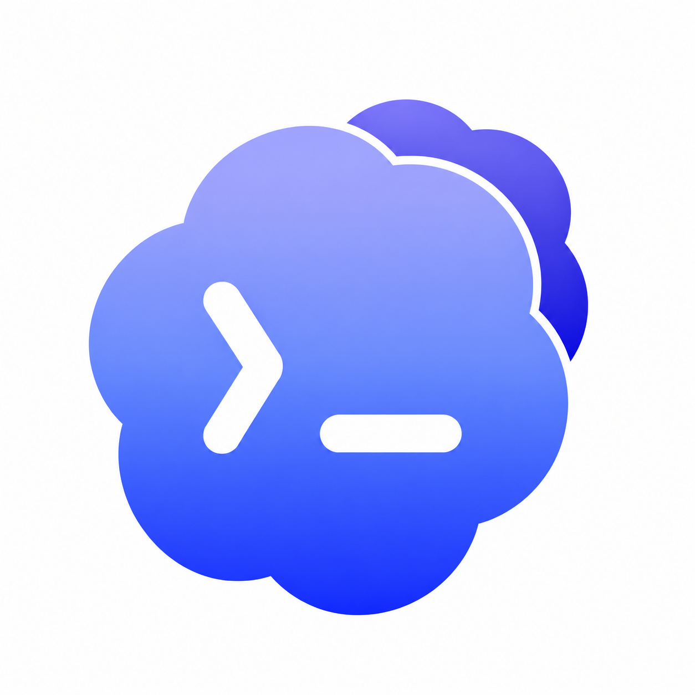

<p align="center">
  
</p>

# codexplus

通过 C/S 架构集中保存 Codex / ChatGPT 凭证，在用户自己的电脑上用 TUI 添加和切换账号。只有一个可执行程序 `codexplus`：

- **服务端**（`codexplus serve`）保存账户凭证，查询账号邮箱，管理配对和客户端授权，向已授权客户端下发凭证。
- **客户端**（`codexplus`）是本机 TUI。添加时上传本机文件，切换时下载所选凭证并写入本机 `~/.codex/auth.json`。Codex、文件操作和任务执行都在客户端电脑上；服务端不运行 Codex 任务。

## 安装

需要 Node.js 22.22.2+（22.x）、24.15.0+（24.x）或 26+。

```sh
npm ci
npm run build
npm install --global .
```

开发时使用 `npm run dev`（客户端）和 `npm run dev:server`（服务端），两者都显式传入 `--home .codexplus`，将数据放在项目根目录已忽略的 `.codexplus/` 中。

## 命令

```sh
codexplus [--server 地址 | --local] [--home 目录]
codexplus serve [--host 127.0.0.1] [--port 47831] [--tls-cert 文件 --tls-key 文件] [--home 目录]
codexplus serve pair|clients|revoke <客户端ID>|log [--limit 条数] [--home 目录]
```

独立 `serve` 监听端口默认 `47831`，可用 `--port` 指定。`--home <目录>` 或 `--home=<目录>` 指定数据目录，默认 `~/.codexplus`，支持绝对路径、相对路径和 `~/`。

## 本机使用

直接运行 `codexplus` 默认使用本机模式；`--local` 切回本机。每个客户端进程自带服务端，监听 127.0.0.1 随机端口，使用仅存在内存的会话令牌，通过相同 HTTP 接口访问数据；退出时关闭，不在授权文件中留下客户端记录。客户端不接受 `--port`。

URL 连接只连接已运行的服务端，失败不自动启动、不修改配置。旧版 client.json 在读取时迁移，丢弃本机自动配对记录，手动配对记录保留，下次保存写入版本 2。原有 config.json 和 credentials/ 继续使用。

## 菜单

启动后顶部显示所连接的服务端、当前 Codex 登录的账号和服务端已保存账号数量，下方是主菜单。方向键移动，回车确认，Esc 返回上一级（在主菜单中退出），Ctrl+C 随时取消。

- **切换账号**：从服务端已保存的邮箱列表中选择，下载对应凭证并写入客户端本机 `~/.codex/auth.json`。当前账号标记为「● 当前」且不可选。当前登录未保存或本机有更新时，会先询问是否保存再切换；与服务端版本不一致时显示两边的刷新时间，可以选择先用本机登录覆盖服务端、不保存直接切换或返回；只有服务端有更新时不提醒保存。写入前检查本机 Codex 进程；检测到时列出进程名和 PID，再次确认，默认取消，只有明确选择继续才切换。切换不再次请求 ChatGPT 账号接口，但需要连接服务端；成功后退出。
- **添加账号**：可以直接上传当前 Codex 登录（`~/.codex/auth.json`），也可以手动输入其他 `auth.json` 路径，支持绝对路径、相对路径、`~/`，以及拖入终端时带引号或 `\ ` 转义空格的路径。按回车确认时会先检查文件是否存在、是否包含 `tokens.access_token`，有问题直接在输入框下方提示。当前 Codex 登录与服务端保存的凭证一致时，不会重复上传。客户端校验并过滤内容后上传，服务端使用 `tokens.access_token` 查询邮箱并保存为 `codex-<邮箱>.json`，查询时显示加载动画，不修改源文件。同一邮箱再次添加须匹配基线摘要，冲突时显示两边刷新时间并确认后重试，不会切换当前账号。上传内容与服务端一致时不写盘，提示「已是最新，无需更新」；添加完成后回到主菜单。

添加或保存失败时显示错误并停留在当前步骤，可以直接重试或按 Esc 返回；路径输入框会保留上次输入的内容。退出时打印一行当前账号。连接、配对或配置读取失败时以非零状态退出，Ctrl+C 取消时正常退出。

状态栏中的当前账号按以下规则识别：`~/.codex/auth.json` 经过同样的字段过滤后，其 SHA-256 摘要与服务端某个已保存凭证的摘要一致时显示为该账号；内容不同但邮箱一致时，根据 client.json 的 baseline 区分「有更新未保存」「服务端有更新版本」「与服务端版本不一致」，服务端有更新时可下载更新本机登录；否则显示为「未保存」。列表返回摘要和刷新时间，识别时不下载凭证。识别结果用于界面展示和切换前的保存提醒，不校验 `id_token` 签名，也不参与添加时的邮箱判定。

## 跨机器使用：手动配对

同一局域网里的两台电脑也属于跨机器使用。远程地址必须使用 HTTPS；客户端不接受远程明文 HTTP，也不跟随重定向。

在服务端电脑上单独启动服务端，可直接提供 TLS：

```sh
codexplus serve --host 0.0.0.0 --port 47831 --tls-cert /path/to/cert.pem --tls-key /path/to/key.pem
```

也可以保持默认的本机 HTTP 监听，通过已有 HTTPS 反向代理对外提供服务。代理需转发请求路径、JSON 内容和 `Authorization` 头，不能向请求添加 `Origin` 头。服务端不会根据 `X-Forwarded-For` 等代理头免除认证。

在服务端电脑上，用与服务端相同的系统用户和 `--home` 生成配对码：

```sh
codexplus serve pair
```

四个管理命令（pair、clients、revoke、log）要求数据目录已存在且是目录，否则报错并显示解析后的路径，提示检查 `--home` 或先运行 `codexplus serve`，不会创建目录。已有空目录仍可使用管理命令。启动服务端和客户端仍会自动创建所需目录。管理命令直接在目录锁内读写授权文件，服务端没有运行也可用；仅接受 `--home`，不接受 `--port`、`--server`。TLS 证书必须受 Node.js 信任并匹配主机名；私有 CA 可通过 NODE_EXTRA_CA_CERTS 指定。

配对码有效期为五分钟，只能使用一次，生成新码会使旧码失效。客户端运行：

```sh
codexplus --server https://codexplus.example.com
```

首次连接时输入配对码（输入隐藏）和客户端名称。客户端会记住所有连接过的服务端及其令牌，并记住当前连接；之后直接运行 `codexplus` 即连接上次的服务端，用 `--server` 切换到已配对的服务端时无需再次配对。重启客户端或服务端不需要重新配对。服务端生成并持久保存实例 UUID，客户端在发送令牌前比较实例；同一地址换成其他目录时需要确认并重新手动配对，取消时配置不变。实例 ID 用于防止误连，并非身份真实性证明。

配对后的客户端可以列出、添加、删除和下载该服务端的全部账户凭证，不能管理配对或撤销其他客户端。HTTP 不提供本机验证或管理接口。

在服务端查看和撤销客户端授权：

```sh
codexplus serve clients
codexplus serve revoke <客户端ID>
```

撤销后客户端下次连接会提示授权已失效并要求重新配对。撤销访问授权不会删除客户端已经下载的 `~/.codex/auth.json`，也不会使其持有的账户 token 在 ChatGPT 上失效。

删除账号需要再次确认（默认取消），按列表摘要提交（凭证文件缺失或损坏时提交 null，删除列表会显示说明，仍可确认删除）；服务端已更新时刷新后重新决定。本机 auth.json 不受删除影响。`serve clients` 显示最近访问时间，无记录为「从未」，每分钟最多更新一次。

`codexplus serve log [--limit 条数] [--home 目录]` 按时间顺序显示最近操作，默认 50 条。记录成功的下载、实际写入的上传、删除、配对、撤销，最多保存 1000 条，不含 token 或凭证内容；每条包含时间、事件、操作者的客户端 ID 和名称，以及账号邮箱或被撤销的客户端。本机模式的操作者记为「本机」，管理命令记为「管理命令」。配对、上传、删除和撤销在完成后记录，记录写入失败不影响结果，只在服务端输出一行警告；下载在返回凭证前记录，记录失败时不返回凭证。

## 文件位置

| 所属 | 用途 | 路径 |
| --- | --- | --- |
| 共享 | 跨进程瞬时锁 | `<home>/.lock` |
| 服务端 | 凭证索引，沿用原格式 | `<home>/config.json` |
| 服务端 | 已保存账户凭证（明文，依赖文件权限保护） | `<home>/credentials/codex-<邮箱>.json` |
| 服务端 | 操作记录（最多 1000 条） | `<home>/audit.log` |
| 服务端 | 实例 UUID、配对码及客户端令牌的哈希 | `<home>/server-access.json` |
| 客户端 | 版本 2：当前 local 或 URL、远程令牌及同步基线 | `<home>/client.json` |
| 客户端 | 当前供本机 Codex 使用的账户凭证 | `~/.codex/auth.json` |

`<home>` 是各自的 `--home` 目录，默认 `~/.codexplus`。客户端只写自己的 `client.json` 和 `~/.codex/auth.json`；凭证库和授权由服务端写入服务端目录。客户端自带的本地服务端使用客户端的 `--home`，因此两类文件可以位于同一目录。客户端添加文件时 `~/` 的含义、进程检测和 `~/.codex/auth.json` 的写入目标以操作系统用户为准，不会被 `--home` 改变。

服务端对配对客户端每次认证都从磁盘读取 `server-access.json`，不保留内存副本，手工修改立即生效。同目录的多个进程通过瞬时 `<home>/.lock` 串行读写；锁等待最多 10 秒，超过 30 秒的残留会回收，回收过程由瞬时的 `<home>/.lock.reclaim` 互斥，避免两个进程同时回收后都拿到锁；这个标记不会自动回收，进程恰好在回收中途崩溃时会留下它，此后残留锁不再被回收，命令会报错并提示在确认没有其他 codexplus 运行后手动删除；进程在写入锁内容前崩溃留下的空锁按文件修改时间判断。账号网络查询在锁外，健康接口不受慢查询阻塞。Windows 原子重命名遇到外部读取占用时重试约 2 秒。

服务端凭证索引不保存 token，格式不变：

```json
{
  "version": 1,
  "credentials": [
    { "type": "codex", "email": "person@example.com" }
  ]
}
```

文件通过同目录临时文件和重命名写入。Unix 上新建的敏感文件权限为 `0600`，新建目录为 `0700`。客户端访问令牌以明文保存在 `client.json` 中，服务端只保存其 SHA-256 哈希；账户凭证文件依赖操作系统文件权限保护，不加密。API 响应禁用缓存，不开放浏览器跨站访问，JSON 请求上限为 128 KiB。

## 凭证内容与 Codex 配置

目前仅支持 `codex` 类型和通过 ChatGPT 登录生成、包含 `tokens.access_token` 的 `auth.json`，不支持只有 API key 的文件。只保留顶层的 `auth_mode`、`OPENAI_API_KEY`、`tokens`、`last_refresh`，以及 `tokens` 内的 `id_token`、`access_token`、`refresh_token`、`account_id`。其他字段全部丢弃；保留字段的原值不变，缺失字段不补齐，已有 `null` 原样保留。

添加时由服务端请求 `https://chatgpt.com/backend-api/me`，发送已有 access token，存在 `tokens.account_id` 时同时发送 `ChatGPT-Account-Id`。邮箱使用响应的顶层 `email` 字段。请求超时为 15 秒，不跟随重定向，错误信息不打印 token 或接口响应内容。该账号资料接口没有公开的稳定契约，可能因接口变更、token 权限或访问限制而失败。失败不会退回到本地解码 token 或凭空生成邮箱。

读取、校验或账号查询失败时不更新已有配置和凭证。服务端索引提交失败时恢复本次替换的凭证。客户端下载失败、授权被撤销或响应无效时，不覆盖当前登录。

程序不登录、不刷新 token；过期后需要在客户端 Codex 中重新登录，再重新添加。服务端保存添加时的快照，客户端 Codex 后续刷新当前登录的 token 不会自动同步回服务端。

切换目标固定为客户端的 `~/.codex/auth.json`，不跟随 `CODEX_HOME`。Codex 需要使用文件凭证存储，并使用默认配置目录；如果当前配置使用系统钥匙串，需要自行设置客户端的 `~/.codex/config.toml`：

```toml
cli_auth_credentials_store = "file"
```

Codex 的存储方式说明见 [OpenAI 官方认证文档](https://developers.openai.com/codex/auth/)。本工具不会修改 Codex 的其他配置。

HTTP 协议版本为 2；连接前检查服务名称和版本，不兼容时不发送令牌。上传包含 `{ auth, base }`，响应为 `{ credential, changed }`，`changed` 表示是否实际写入；相同内容不记上传操作记录，上传当前 Codex 登录时仍记录同步基线。冲突返回 409，确认后以最新摘要重试；没有强制覆盖开关。切换、保存当前登录和下载更新后记录基线，从其他文件添加不记录。

服务端仅提供以下接口；除健康检查和配对外均需访问令牌：

| 方法与路径 | 内容 |
| --- | --- |
| GET /v1/health | 服务名称、协议版本 2、实例 id |
| POST /v1/pair | 配对码换取令牌 |
| GET /v1/session | 验证授权 |
| GET /v1/credentials | 账号、摘要、lastRefresh |
| POST /v1/credentials | 上传 `{ auth, base }` |
| POST /v1/credentials/download | 按 type、email 下载 |
| POST /v1/credentials/delete | 按 type、email、base（摘要或 null，必填）条件删除 |

旧的 local-codes/ 目录不再读取或写入，可以自行删除。交互流程在 src/flows.ts，配对、重新配对和覆盖确认的提示在 src/prompts.ts。

## 开发与验证

```sh
npm ci
npm run check
npm pack --dry-run
```

`check` 运行 ESLint、TypeScript 类型检查、测试和构建。ESLint 限制每个 JavaScript / TypeScript 文件最多 500 行（包含空行），并强制禁止行注释、块注释和 JSDoc；可执行文件的 shebang 不属于代码注释。

测试使用独立临时主目录、真实本机 HTTP 服务和模拟账号查询接口，覆盖字段过滤、原有凭证兼容、存储回滚、自带本地服务端、独立本机端口、版本检查、远程配对、多服务端记忆、一次性及过期配对码、离线管理、并发上传、重启后认证、授权撤销及重新配对、请求限制、条件删除、最近访问时间、五类操作记录与裁剪、客户端本地写入和 Unix 文件权限，不读取本机真实凭证。CI 在 Linux、macOS 和 Windows 上使用 Node.js 22、24 执行检查。
